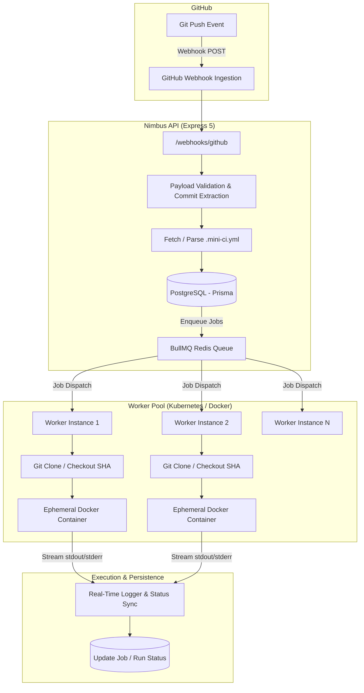

<div align="center">

# ⚡ Nimbus CI

### Lightweight, Distributed, Self-Hosted Continuous Integration Platform

[](https://nodejs.org/)
[](https://www.typescriptlang.org/)
[](https://bullmq.io/)
[](https://www.docker.com/)
[](https://kubernetes.io/)
[](https://www.prisma.io/)
[](https://turbo.build/)

<p align="center">
  <b>Nimbus CI</b> is a production-patterned, modular, distributed Continuous Integration (CI) engine inspired by GitHub Actions. It ingests webhook push events, schedules jobs across Redis queues, distributes workloads across scalable worker nodes, and executes user-defined CI pipelines in isolated ephemeral Docker containers.
</p>

---

</div>

## 📑 Table of Contents

- [Overview & Architecture](#-overview--architecture)
- [Key Features](#-key-features)
- [Monorepo Structure](#-monorepo-structure)
- [Workflow Configuration (`.mini-ci.yml`)](#-workflow-configuration-mini-ciyml)
- [Getting Started](#-getting-started)
  - [Prerequisites](#prerequisites)
  - [Installation & DB Setup](#installation--db-setup)
  - [Running Locally](#running-locally)
- [Containerization & Infrastructure](#-containerization--infrastructure)
  - [Docker Compose](#docker-compose)
  - [Kubernetes Deployment](#kubernetes-deployment)
- [Environment Variables](#-environment-variables)
- [Roadmap & Architecture Milestones](#-roadmap--architecture-milestones)

---

## 🏗 Overview & Architecture

Nimbus CI operates as an event-driven, decoupled distributed system:



### End-to-End Execution Lifecycle:
1. **Webhook Ingestion**: Developer pushes to GitHub $\rightarrow$ GitHub sends a `push` payload to `/webhooks/github`.
2. **Workflow Parsing**: Nimbus API fetches `.mini-ci.yml` from the repository at the given commit SHA, validates syntax, and normalizes job steps and environment variables.
3. **Queue Scheduling**: API creates atomic database records (`WorkflowRun`, `Job`) in PostgreSQL and pushes tasks to BullMQ (`ci-jobs` queue).
4. **Distributed Execution**: BullMQ worker nodes consume jobs concurrently. Each worker clones the exact commit into a sandbox workspace.
5. **Docker Isolation**: Ephemeral Docker containers are spun up per job with custom runtime images (e.g. `node:22`, `python:3.13`, `alpine:latest`). Missing images are automatically pulled on-demand.
6. **Step Execution & Logging**: Commands are executed sequentially in the container. Exit codes determine success/failure, and logs are captured and persisted.
7. **Workspace & Container Cleanup**: Containers are stopped and removed, and temporary workspaces are securely cleaned up in a guaranteed `finally` block.

---

## ✨ Key Features

- **Decoupled Event-Driven Ingestion**: Stateless REST API built with Express 5, Zod validation, and Helmet security.
- **Declarative YAML Pipelines**: Simple, readable `.mini-ci.yml` workflow definitions with multi-job parallel execution support.
- **Sandboxed Container Execution**: Fully isolated step runner powered by `dockerode`, automatically downloading required Docker images and handling volume binds.
- **Distributed Queue Scheduling**: High-throughput task distribution via BullMQ and Redis with automatic backoff retries and concurrency control.
- **Cloud-Native Kubernetes Ready**: Multi-replica worker deployments with Docker-in-Docker (DinD) sidecar architecture for zero-dependency container orchestration.
- **PostgreSQL & Prisma Persistence**: Fully typed relational models for Repositories, Workflows, Runs, Jobs, Logs, and Runners.
- **Modular Monorepo**: Managed with `pnpm` workspaces and Turborepo for fast builds and shared internal packages.

---

## 📂 Monorepo Structure

```text
nimbus_ci/
├── apps/
│   ├── api/                 # Express REST API & GitHub Webhook Ingestion Service
│   │   ├── src/
│   │   │   ├── config/      # Zod environment variable parsing
│   │   │   ├── controllers/ # HTTP controllers (webhooks, repos, runs, jobs)
│   │   │   ├── routes/      # REST API route definitions
│   │   │   ├── services/    # Webhook processor, workflow parser, job enqueuer
│   │   │   └── server.ts    # API entry point (port 8000)
│   ├── worker/              # Distributed BullMQ Worker Daemon
│   │   ├── src/
│   │   │   ├── git/         # Git checkout manager (shallow fetch by commit SHA)
│   │   │   ├── workspace/   # Ephemeral workspace file system manager
│   │   │   └── worker.ts    # BullMQ worker listener and container runner
│   ├── streamer/            # Real-time WebSocket log streaming server (planned)
│   └── web/                 # Next.js UI dashboard (planned)
├── packages/
│   ├── db/                  # Prisma schema, migrations, and database client
│   ├── docker-utils/        # Dockerode wrapper, image puller, and container runner
│   ├── queue/               # BullMQ queues and shared ioredis connection
│   ├── logger/              # Structured Winston application logger
│   ├── ui/                  # Shared React / UI design system
│   ├── eslint-config/       # Shared linting configuration
│   └── typescript-config/   # Shared TypeScript configurations
├── infra/
│   ├── docker/              # Dockerfiles (Dockerfile.worker, Dockerfile.api)
│   ├── docker-compose.yaml  # Redis, PostgreSQL, and Worker local stack
│   └── k8s/                 # Kubernetes deployment manifests (worker + DinD sidecar)
├── package.json             # Root monorepo configuration
├── pnpm-workspace.yaml      # pnpm workspace definition
└── turbo.json               # Turborepo task pipeline
```

---

## 📝 Workflow Configuration (`.mini-ci.yml`)

Create a `.mini-ci.yml` file in the root of your target Git repository to configure your CI pipeline:

```yaml
name: "CI Pipeline"

jobs:
  lint-and-test:
    image: node:22-alpine
    env:
      NODE_ENV: test
      CI: "true"
    steps:
      - node -v
      - npm -v
      - echo "Installing dependencies..."
      - npm ci
      - echo "Running tests..."
      - npm test

  python-build:
    image: python:3.13-slim
    env:
      APP_ENV: test
      PYTHON_ENV: ci
    steps:
      - python --version
      - echo "Running Python tests..."
      - python -m unittest discover -s tests

  system-healthcheck:
    image: alpine:latest
    steps:
      - cat /etc/os-release
      - echo "Running system checks..."
      - uname -a
```

---

## 🚀 Getting Started

### Prerequisites
- **Node.js**: `v22+`
- **pnpm**: `v11+` (`npm install -g pnpm`)
- **Docker**: Docker Desktop / Docker Engine running
- **Git**

### Installation & DB Setup

1. **Clone the repository**:
   ```bash
   git clone https://github.com/harshit-technocrat11/nimbus-CI.git
   cd nimbus-CI
   ```

2. **Install dependencies**:
   ```bash
   pnpm install
   ```

3. **Start local infrastructure (PostgreSQL & Redis)**:
   ```bash
   docker compose -f infra/docker-compose.yaml up -d postgres redis
   ```

4. **Initialize Database**:
   ```bash
   # Generate Prisma Client
   pnpm db:generate

   # Push schema migrations
   pnpm db:migrate
   ```

### Running Locally

Run all services concurrently using Turborepo:
```bash
pnpm dev
```

Or run individual services:
```bash
# Start API Service (Port 8000)
pnpm --filter api dev

# Start Background Worker
pnpm --filter worker dev
```

Expose the webhook API to receive GitHub events (via ngrok):
```bash
ngrok http 8000
```
Set your GitHub repository webhook payload URL to: `https://<your-ngrok-subdomain>.ngrok-free.app/webhooks/github` (Content type: `application/json`).

---

## 🐳 Containerization & Infrastructure

### Docker Compose
Run the entire stack (PostgreSQL, Redis, and Worker) using Docker Compose:
```bash
docker compose -f infra/docker-compose.yaml up -d
```
View worker logs:
```bash
docker compose -f infra/docker-compose.yaml logs -f worker
```

### Kubernetes Deployment
Deploy scalable worker pods with an isolated **Docker-in-Docker (DinD)** sidecar in Kubernetes:

```bash
# Apply worker deployment (2 replicas by default)
kubectl apply -f infra/k8s/worker-deployment.yaml

# Check running pods
kubectl get pods -l app=nimbus-worker

# Stream logs from all worker instances
kubectl logs -l app=nimbus-worker -f --prefix

# Scale workers dynamically
kubectl scale deployment nimbus-worker --replicas=4
```

---

## ⚙️ Environment Variables

| Variable | Default | Service | Description |
| :--- | :--- | :--- | :--- |
| `PORT` | `8000` | API | HTTP port for REST API & Webhooks |
| `DATABASE_URL` | `postgresql://...` | API / DB | PostgreSQL connection string |
| `REDIS_HOST` | `localhost` | API / Worker | Redis host for BullMQ task queue |
| `REDIS_PORT` | `6379` | API / Worker | Redis port |
| `DOCKER_SOCKET` | `/var/run/docker.sock` | Worker | Path to host Docker Unix socket (or Windows pipe) |
| `DOCKER_HOST` | - | Worker | Docker daemon TCP endpoint (e.g. `tcp://localhost:2375` for DinD) |
| `WORKSPACE_ROOT`| `./workspaces` | Worker | Directory path for temporary Git checkouts |
| `LOG_LEVEL` | `info` | All | Logger verbosity (`debug`, `info`, `warn`, `error`) |

---

## 🗺 Roadmap & Architecture Milestones

- [x] **Milestone 1**: Monorepo architecture (`pnpm` + Turborepo), TypeScript configs, and Winston logger.
- [x] **Milestone 2**: PostgreSQL schema, Prisma ORM models, and Redis BullMQ task queue.
- [x] **Milestone 3**: Ephemeral Docker sandboxing engine (`dockerode`) with auto image pulling.
- [x] **Milestone 4**: Event-driven GitHub Webhook ingestion and `.mini-ci.yml` parser.
- [x] **Milestone 5**: Worker containerization and Kubernetes multi-replica scaling with DinD sidecar.
- [ ] **Milestone 6**: Real-time log streaming service (`apps/streamer`) via WebSockets.
- [ ] **Milestone 7**: Web dashboard UI (`apps/web`) with live build execution progress.

---

<div align="center">
  <sub>Built with ❤️ for understanding distributed Continuous Integration systems.</sub>
</div>